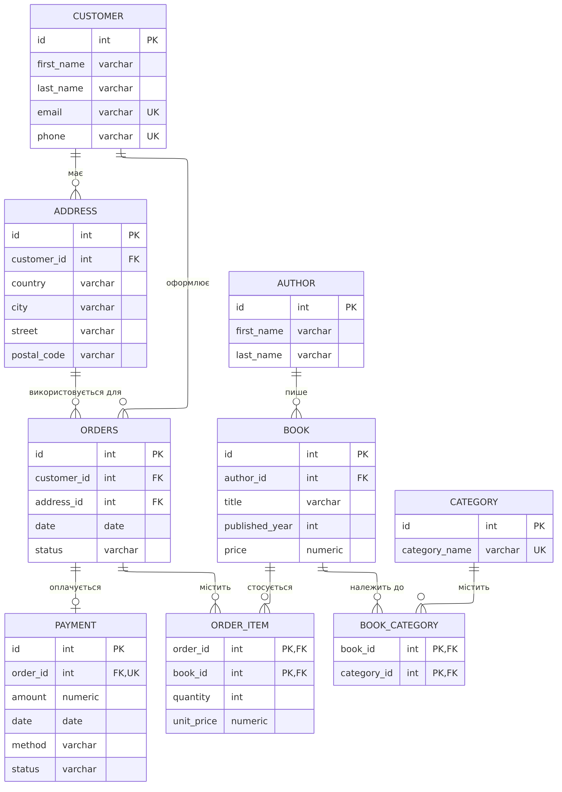

# Опис схеми бази даних

СУБД: PostgreSQL 16. Схема містить 9 таблиць. Скрипти створення таблиць, індексів і демо-даних лежать у теці `migrations/` і виконуються по черзі при першому запуску контейнера.

## ER-діаграма

Джерело діаграми: [`ER-diagram.mmd`](./ER-diagram.mmd) (Mermaid). Після зміни схеми діаграму треба оновити там і перегенерувати PNG.

## Таблиці

### customer

Клієнти магазину. Один запис — одна людина, яка може оформлювати замовлення.

| Колонка      | Тип          | Обмеження        | Опис                                     |
| ------------ | ------------ | ---------------- | ---------------------------------------- |
| `id`         | INTEGER      | PK, IDENTITY     | Ідентифікатор клієнта                    |
| `first_name` | VARCHAR(100) | NOT NULL         | Ім'я                                     |
| `last_name`  | VARCHAR(100) | NOT NULL         | Прізвище                                 |
| `email`      | VARCHAR(255) | NOT NULL, UNIQUE | Email, за яким клієнта шукають і з ним зв'язуються |
| `phone`      | VARCHAR(20)  | NOT NULL, UNIQUE | Телефон у форматі `+380...`              |

**Індекси:** PK на `id`; унікальні індекси на `email` і `phone`, які PostgreSQL створює автоматично для `UNIQUE`.

**Зв'язки:** має багато адрес (`address`) і багато замовлень (`orders`).

### address

Адреси доставки клієнтів. У клієнта може бути кілька адрес, і для кожного замовлення він обирає одну з них.

| Колонка       | Тип          | Обмеження                                           | Опис                                     |
| ------------- | ------------ | --------------------------------------------------- | ---------------------------------------- |
| `id`          | INTEGER      | PK, IDENTITY                                        | Ідентифікатор адреси                     |
| `customer_id` | INTEGER      | NOT NULL, FK -> `customer(id)`, `ON DELETE CASCADE` | Клієнт, якому належить адреса            |
| `country`     | VARCHAR(100) | NOT NULL                                            | Країна                                   |
| `city`        | VARCHAR(100) | NOT NULL                                            | Місто                                    |
| `street`      | VARCHAR(255) | NOT NULL                                            | Вулиця, будинок, квартира                |
| `postal_code` | VARCHAR(20)  | необов'язкове                                       | Поштовий індекс                          |

**Індекси:** PK на `id`; `idx_address_customer_id` на `customer_id`; `idx_address_city` на `city`.

**Зв'язки:** належить одному клієнту; на адресу може посилатися багато замовлень.

### author

Автори книг.

| Колонка      | Тип          | Обмеження    | Опис                  |
| ------------ | ------------ | ------------ | --------------------- |
| `id`         | INTEGER      | PK, IDENTITY | Ідентифікатор автора  |
| `first_name` | VARCHAR(100) | NOT NULL     | Ім'я                  |
| `last_name`  | VARCHAR(100) | NOT NULL     | Прізвище              |

**Індекси:** PK на `id`.

**Зв'язки:** автор має багато книг (`book`).

### category

Жанри, за якими групуються книги в каталозі.

| Колонка         | Тип         | Обмеження        | Опис                     |
| --------------- | ----------- | ---------------- | ------------------------ |
| `id`            | INTEGER     | PK, IDENTITY     | Ідентифікатор категорії  |
| `category_name` | VARCHAR(60) | NOT NULL, UNIQUE | Назва категорії          |

**Індекси:** PK на `id`; унікальний індекс на `category_name`.

**Зв'язки:** багато до багатьох із `book` через `book_category`.

### book

Каталог книг, які продає магазин.

| Колонка          | Тип           | Обмеження                      | Опис                                         |
| ---------------- | ------------- | ------------------------------ | -------------------------------------------- |
| `id`             | INTEGER       | PK, IDENTITY                   | Ідентифікатор книги                          |
| `author_id`      | INTEGER       | NOT NULL, FK -> `author(id)`   | Автор книги                                  |
| `title`          | VARCHAR(200)  | NOT NULL                       | Назва                                        |
| `published_year` | INTEGER       | CHECK (`published_year > 0`)   | Рік видання, може бути невідомим (`NULL`)    |
| `price`          | NUMERIC(10,2) | NOT NULL, CHECK (`price >= 0`) | Поточна ціна в гривнях                       |

**Індекси:** PK на `id`; `idx_book_author_id` на `author_id`.

**Зв'язки:** належить одному автору; багато до багатьох із `category` через `book_category`; на книгу посилаються позиції замовлень `order_item`.

### book_category

Таблиця зв'язку між книгами й категоріями. Одна книга може належати до кількох категорій («Воно» — і «Жахи», і «Трилер»), а категорія містить багато книг.

| Колонка       | Тип     | Обмеження                                             | Опис      |
| ------------- | ------- | ----------------------------------------------------- | --------- |
| `book_id`     | INTEGER | NOT NULL, FK -> `book(id)`, частина складеного PK     | Книга     |
| `category_id` | INTEGER | NOT NULL, FK -> `category(id)`, частина складеного PK | Категорія |

**Індекси:** складений PK `(book_id, category_id)`. Він не дає прив'язати книгу до однієї категорії двічі й прискорює пошук категорій книги.

**Зв'язки:** кожен рядок посилається на одну книгу й одну категорію. Зовнішні ключі без `CASCADE`, тому перед видаленням книги її рядки тут треба видалити явно (так робить `delete_book_not_in_orders`).

### orders

Замовлення клієнтів. Назва в множині, бо `order` — зарезервоване слово SQL.

| Колонка       | Тип         | Обмеження                                                                             | Опис                         |
| ------------- | ----------- | ------------------------------------------------------------------------------------- | ---------------------------- |
| `id`          | INTEGER     | PK, IDENTITY                                                                          | Номер замовлення             |
| `customer_id` | INTEGER     | NOT NULL, FK -> `customer(id)`, `ON DELETE RESTRICT`                                  | Клієнт, який оформив         |
| `address_id`  | INTEGER     | NOT NULL, FK -> `address(id)`, `ON DELETE RESTRICT`                                   | Адреса доставки              |
| `date`        | DATE        | NOT NULL, DEFAULT `CURRENT_DATE`                                                      | Дата оформлення              |
| `status`      | VARCHAR(20) | NOT NULL, DEFAULT `'нове'`, CHECK: нове, збирається, відправлено, отримано, скасовано | Стан обробки замовлення      |

**Індекси:** PK на `id`; `idx_orders_customer_id` на `customer_id`; `idx_orders_address_id` на `address_id`.

**Зв'язки:** належить одному клієнту й одній адресі; містить багато позицій `order_item`; має не більше одного платежу `payment`.

### order_item

Позиції замовлення: яку книгу, скільки примірників і за якою ціною купили.

| Колонка      | Тип           | Обмеження                                           | Опис                                   |
| ------------ | ------------- | --------------------------------------------------- | -------------------------------------- |
| `order_id`   | INTEGER       | NOT NULL, FK -> `orders(id)`, частина складеного PK | Замовлення                             |
| `book_id`    | INTEGER       | NOT NULL, FK -> `book(id)`, частина складеного PK   | Книга                                  |
| `quantity`   | INTEGER       | NOT NULL, CHECK (від 1 до 10)                       | Кількість примірників                  |
| `unit_price` | NUMERIC(10,2) | NOT NULL, CHECK (`unit_price >= 0`)                 | Ціна одного примірника на момент замовлення |

**Індекси:** складений PK `(order_id, book_id)`. Одна книга входить у замовлення лише однією позицією, а кількість зберігається в `quantity`. Індекс прискорює вибірку позицій конкретного замовлення.

**Зв'язки:** асоціативна таблиця «багато до багатьох» між `orders` і `book` із власними атрибутами.

### payment

Оплата замовлення.

| Колонка    | Тип           | Обмеження                                             | Опис                               |
| ---------- | ------------- | ----------------------------------------------------- | ---------------------------------- |
| `id`       | INTEGER       | PK, IDENTITY                                          | Ідентифікатор платежу              |
| `order_id` | INTEGER       | NOT NULL, UNIQUE, FK -> `orders(id)`                  | Замовлення, за яке платять         |
| `amount`   | NUMERIC(10,2) | NOT NULL, CHECK (`amount >= 0`)                       | Сума до оплати                     |
| `date`     | DATE          | NOT NULL, DEFAULT `CURRENT_DATE`                      | Дата створення платежу             |
| `method`   | VARCHAR(20)   | NOT NULL, CHECK: картка, готівка                      | Спосіб оплати                      |
| `status`   | VARCHAR(20)   | NOT NULL, DEFAULT `'очікує'`, CHECK: очікує, оплачено | Чи отримано гроші                  |

**Індекси:** PK на `id`; унікальний індекс на `order_id`.

**Зв'язки:** належить одному замовленню. Через `UNIQUE` на `order_id` у замовлення не може бути двох платежів.

## Зв'язки та поведінка при видаленні

| Зв'язок                 | Тип                           | Якщо видалити батьківський рядок                                   |
| ----------------------- | ----------------------------- | ------------------------------------------------------------------ |
| `customer` -> `address` | 1 до багатьох                 | `CASCADE`: адреси видаляються разом із клієнтом                    |
| `customer` -> `orders`  | 1 до багатьох                 | `RESTRICT`: клієнта, який має замовлення, видалити не можна        |
| `address` -> `orders`   | 1 до багатьох                 | `RESTRICT`: адресу, на яку є замовлення, видалити не можна         |
| `author` -> `book`      | 1 до багатьох                 | `NO ACTION`: автора, на якого посилаються книги, видалити не можна |
| `book` та `category`    | багато до багатьох            | через `book_category`, `NO ACTION`                                 |
| `orders` та `book`      | багато до багатьох            | через `order_item`, `NO ACTION`                                    |
| `orders` -> `payment`   | 1 до 0..1 (завдяки `UNIQUE`)  | `NO ACTION`                                                        |

## Рішення щодо дизайну

### Чому така структура

- Кожна сутність предметної області (клієнт, адреса, автор, категорія, книга, замовлення, позиція, платіж) має окрему таблицю. Так кожен факт зберігається в одному місці.
- Адреси винесені з `customer`, бо в клієнта їх може бути кілька, а замовлення має посилатися на конкретну адресу доставки.
- Зв'язки «багато до багатьох» (`book`–`category`, `orders`–`book`) реалізовані через таблиці зв'язку зі складеним PK. `order_item` додатково зберігає кількість і ціну.
- Платіж винесено в окрему таблицю, бо в нього свій життєвий цикл (`очікує` → `оплачено`) і свої атрибути, а не кожне замовлення вже має платіж.

### Нормалізація (3НФ)

- **1НФ:** усі значення атомарні, немає списків у полях. Категорії книги — окремі рядки в `book_category`, а не рядок «Жахи, Трилер».
- **2НФ:** у таблицях зі складеним ключем (`book_category`, `order_item`) кожен неключовий атрибут залежить від усього ключа: `quantity` і `unit_price` описують саме цю книгу в цьому замовленні.
- **3НФ:** неключові атрибути не залежать один від одного. Ім'я автора лежить в `author`, а не дублюється в `book`; назва категорії — у `category`; сума замовлення не зберігається в `orders`, а рахується з `order_item`.

### Вибір типів і обмежень

- `price`, `unit_price` і `amount` мають тип `NUMERIC(10,2)`, а не `FLOAT`, щоб не було похибок округлення в грошових сумах.
- `postal_code` і `phone` — текст (`VARCHAR`), щоб не губились нулі на початку (`02291`) і `+` у номері.
- `id` усіх таблиць створюється через `GENERATED ALWAYS AS IDENTITY`: це стандарт SQL, база не дає вписати `id` вручну, тому лічильник не розсинхронізується з даними.
- `date` в `orders` і `payment` має тип `DATE`: для магазину важливий день, час не потрібен.
- `CHECK` (`price >= 0`, `quantity` від 1 до 10, перелік статусів і способів оплати) захищають дані на рівні бази, навіть якщо хтось змінить їх в обхід застосунку.
- `ON DELETE CASCADE` для адрес, бо адреса без клієнта не має сенсу. `ON DELETE RESTRICT` для замовлень, щоб разом із клієнтом чи адресою не зникла історія замовлень.

### Компроміси

Кілька місць свідомо відходять від суворої нормалізації:

- **`order_item.unit_price` дублює `book.price`.** Це навмисно: ціна в каталозі змінюється, а в оформленому замовленні має лишитися та ціна, за яку купили. `change_book_price` змінює лише `book.price`, і тест перевіряє, що `unit_price` старих замовлень не змінюється.
- **`payment.amount` дублює суму позицій.** Платіж — окремий фінансовий факт: сума, яку клієнт має заплатити. Застосунок перераховує її при кожній зміні позицій: при додаванні (`create_pending_payment`) і при видаленні (`remove_order_item`).
- **`orders.customer_id` можна вивести через `address.customer_id`.** Його залишено, щоб замовлення клієнта шукались без `JOIN` з адресами і щоб історія замовлень була прив'язана до клієнта напряму. Узгодженість («адреса належить клієнту замовлення») перевіряє застосунок.

### Правила, які перевіряє застосунок, а не база

`CHECK` у PostgreSQL бачить лише один рядок однієї таблиці, тому правила, де треба дивитись в інші таблиці або на попередній стан, перевіряються в сервісах у транзакції, часто з блокуванням `FOR UPDATE`:

| Правило | Де перевіряється |
| --- | --- |
| Адреса замовлення належить клієнту замовлення | `check_address_owner`, `change_order_address`, `create_order` |
| Статус замовлення змінюється лише за дозволеними переходами | `ALLOWED_TRANSITIONS`, `change_order_status` |
| Замовлення не порожнє, сума платежу = сумі позицій | `create_order`, `add_items_to_order`, `remove_order_item` |
| Готівку підтверджують лише після статусу «отримано» | `confirm_cash_payment` |
| Книга має хоча б одну категорію | `create_book_with_categories` |
| Ціну книги змінюють не більше ніж на 50% за раз | `change_book_price` |

Ці правила можна було б реалізувати тригерами, але тоді логіка була б розкидана між базою й кодом і її складніше тестувати. Щоб знайти порушення, якщо дані змінили в обхід застосунку, є запит `orders_audit()`.

### Стратегія індексування

- **Первинні й унікальні ключі** PostgreSQL індексує автоматично: `id` усіх таблиць, `customer.email`, `customer.phone`, `category.category_name`, `payment.order_id`, складені PK `book_category` і `order_item`.
- **Зовнішні ключі** PostgreSQL сам не індексує, тому для тих, за якими часто роблять `JOIN` або фільтр, індекси додано в `002_add_indexes.sql`: `address.customer_id`, `orders.customer_id`, `orders.address_id`, `book.author_id`.
- **Часті фільтри:** `address.city`, бо за містом шукають адреси й групують продажі.
- **Складений PK покриває лише першу колонку окремо.** `order_item (order_id, book_id)` прискорює пошук за `order_id`, а `book_category (book_id, category_id)` — за `book_id`. Пошук за `order_item.book_id` і `book_category.category_id` поки йде без окремого індексу: на розмірі навчальної бази це не помітно. Якщо даних стане багато, це перші кандидати на нові індекси.
- **Індекси не додано «про запас»:** кожен індекс сповільнює `INSERT` і `UPDATE`, тому їх створено лише під наявні запити.

## Тестові дані

### author

| id  | first_name | last_name |
| --- | ---------- | --------- |
| 1   | Джоан      | Роулінг   |
| 2   | Чак        | Поланік   |
| 3   | Стівен     | Кінг      |
| 4   | Ліна       | Костенко  |
| 5   | Тарас      | Шевченко  |
| 6   | Агата      | Крісті    |
| 7   | Г. Д.      | Карлтон   |

### category

| id  | category_name      |
| --- | ------------------ |
| 1   | Фентезі            |
| 2   | Детектив           |
| 3   | Жахи               |
| 4   | Поезія             |
| 5   | Наукова фантастика |
| 6   | Трилер             |
| 7   | Романтика          |

### book

| id  | author_id | title                              | published_year | price  |
| --- | --------- | ---------------------------------- | -------------- | ------ |
| 1   | 1         | Гаррі Поттер і філософський камінь | 1997           | 350.00 |
| 2   | 2         | Бійцівський клуб                   | 1996           | 300.00 |
| 3   | 3         | Воно                               | 1986           | 420.00 |
| 4   | 4         | Маруся Чурай                       | 1979           | 200.00 |
| 5   | 5         | Кобзар                             | 1840           | 180.00 |
| 6   | 6         | Вбивство у Східному експресі       | 1934           | 260.00 |
| 7   | 7         | Переслідування Аделіни             | 2021           | 430.00 |

### book_category

| book_id | category_id |
| ------- | ----------- |
| 1       | 1           |
| 2       | 6           |
| 3       | 3           |
| 3       | 6           |
| 4       | 4           |
| 5       | 4           |
| 6       | 2           |
| 7       | 6           |
| 7       | 7           |

### customer

| id  | first_name | last_name | email                         | phone         |
| --- | ---------- | --------- | ----------------------------- | ------------- |
| 1   | Олена      | Іваненко  | diva@gmail.com                | +380501112233 |
| 2   | Марк       | Цукерберг | zuckerbergpromax@gmail.com    | +380671234567 |
| 3   | Софія      | Ковальчук | sofiabondarenko1999@gmail.com | +380931234567 |
| 4   | Артем      | Пивоваров | hornyboy@gmail.com            | +380971234567 |
| 5   | Дарина     | Бойко     | slay@gmail.com                | +380631234567 |

### address

| id  | customer_id | country | city     | street                  | postal_code |
| --- | ----------- | ------- | -------- | ----------------------- | ----------- |
| 1   | 1           | Україна | Київ     | вул. Борщагівська 14    | 01067       |
| 2   | 1           | Україна | Київ     | просп. Берестейський 25 | 03257       |
| 3   | 2           | США     | Нью-Йорк | вул. Зодчих 5           | 79722       |
| 4   | 3           | Україна | Одеса    | вул. Дерибасівська 12   | 65900       |
| 5   | 4           | Україна | Харків   | вул. Соборна 3А         | 11330       |
| 6   | 5           | Україна | Житомир  | просп. Перемоги 2       | 49008       |

### orders

| id  | customer_id | address_id | date       | status      |
| --- | ----------- | ---------- | ---------- | ----------- |
| 1   | 1           | 1          | 2025-09-01 | отримано    |
| 2   | 1           | 2          | 2025-09-15 | відправлено |
| 3   | 2           | 3          | 2025-09-20 | збирається  |
| 4   | 3           | 4          | 2025-10-01 | нове        |
| 5   | 4           | 5          | 2025-10-03 | скасовано   |

### order_item

| order_id | book_id | quantity | unit_price |
| -------- | ------- | -------- | ---------- |
| 1        | 1       | 1        | 350.00     |
| 2        | 2       | 2        | 300.00     |
| 3        | 4       | 1        | 200.00     |
| 4        | 6       | 1        | 260.00     |
| 5        | 7       | 2        | 430.00     |

### payment

| id  | order_id | amount | date       | method  | status   |
| --- | -------- | ------ | ---------- | ------- | -------- |
| 1   | 1        | 350.00 | 2025-09-02 | картка  | оплачено |
| 2   | 2        | 600.00 | 2025-09-16 | готівка | очікує   |
| 3   | 3        | 200.00 | 2025-09-20 | картка  | очікує   |
| 4   | 4        | 260.00 | 2025-10-01 | готівка | очікує   |
| 5   | 5        | 860.00 | 2025-10-03 | картка  | очікує   |
