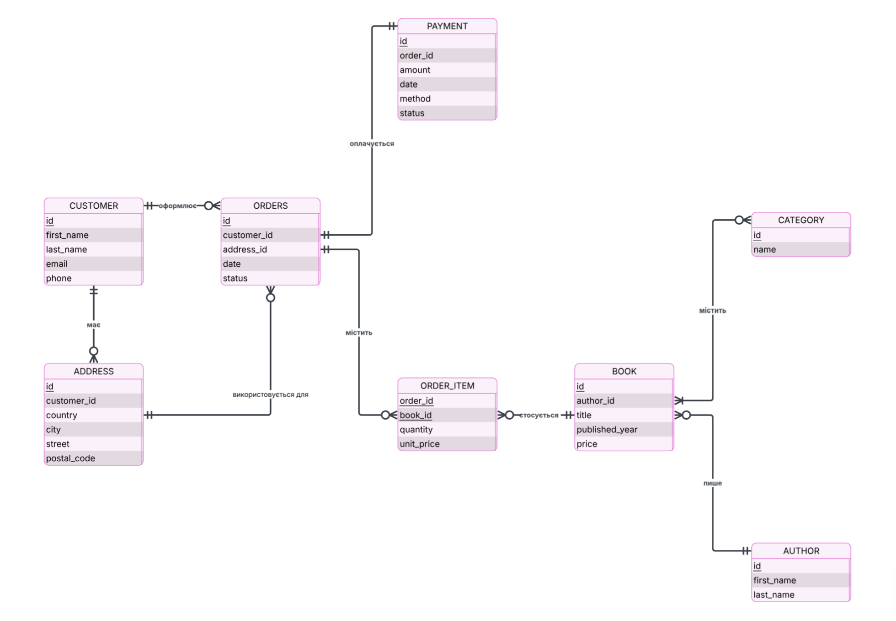

# Опис схеми бази даних

СУБД: PostgreSQL. Схема містить 9 таблиць, їх повний скрипт створення й тестових даних у `schema.sql`.

## ER-діаграма

## Таблиці

### customer

| Колонка      | Тип          | Обмеження        |
| ------------ | ------------ | ---------------- |
| `id`         | INTEGER      | PK, IDENTITY     |
| `first_name` | VARCHAR(100) | NOT NULL         |
| `last_name`  | VARCHAR(100) | NOT NULL         |
| `email`      | VARCHAR(255) | NOT NULL, UNIQUE |
| `phone`      | VARCHAR(20)  | NOT NULL, UNIQUE |

### address

| Колонка           | Тип          | Обмеження                                           |
| ----------------- | ------------ | --------------------------------------------------- |
| `id`              | INTEGER      | PK, IDENTITY                                        |
| `customer_id`     | INTEGER      | NOT NULL, FK -> `customer(id)`, `ON DELETE CASCADE` |
| `country`, `city` | VARCHAR(100) | NOT NULL                                            |
| `street`          | VARCHAR(255) | NOT NULL                                            |
| `postal_code`     | VARCHAR(20)  | необов'язкове                                       |

### author

| Колонка                   | Тип          | Обмеження    |
| ------------------------- | ------------ | ------------ |
| `id`                      | INTEGER      | PK, IDENTITY |
| `first_name`, `last_name` | VARCHAR(100) | NOT NULL     |

### category

| Колонка         | Тип         | Обмеження        |
| --------------- | ----------- | ---------------- |
| `id`            | INTEGER     | PK, IDENTITY     |
| `category_name` | VARCHAR(60) | NOT NULL, UNIQUE |

### book

| Колонка          | Тип           | Обмеження                      |
| ---------------- | ------------- | ------------------------------ |
| `id`             | INTEGER       | PK, IDENTITY                   |
| `author_id`      | INTEGER       | NOT NULL, FK -> `author(id)`   |
| `title`          | VARCHAR(200)  | NOT NULL                       |
| `published_year` | INTEGER       | CHECK (`published_year > 0`)   |
| `price`          | NUMERIC(10,2) | NOT NULL, CHECK (`price >= 0`) |

### book_category

| Колонка       | Тип     | Обмеження                                             |
| ------------- | ------- | ----------------------------------------------------- |
| `book_id`     | INTEGER | NOT NULL, FK -> `book(id)`, частина складеного PK     |
| `category_id` | INTEGER | NOT NULL, FK -> `category(id)`, частина складеного PK |

Складений первинний ключ `(book_id, category_id)` реалізує зв'язок "багато до багатьох" між книгами та категоріями: одна книга може належати до кількох категорій, одна категорія містить багато книг.

### orders

| Колонка       | Тип         | Обмеження                                                                             |
| ------------- | ----------- | ------------------------------------------------------------------------------------- |
| `id`          | INTEGER     | PK, IDENTITY                                                                          |
| `customer_id` | INTEGER     | NOT NULL, FK -> `customer(id)`, `ON DELETE RESTRICT`                                  |
| `address_id`  | INTEGER     | NOT NULL, FK -> `address(id)`, `ON DELETE RESTRICT`                                   |
| `date`        | DATE        | NOT NULL, DEFAULT `CURRENT_DATE`                                                      |
| `status`      | VARCHAR(20) | NOT NULL, DEFAULT `'нове'`, CHECK: нове, збирається, відправлено, отримано, скасовано |

### order_item

| Колонка      | Тип           | Обмеження                                           |
| ------------ | ------------- | --------------------------------------------------- |
| `order_id`   | INTEGER       | NOT NULL, FK -> `orders(id)`, частина складеного PK |
| `book_id`    | INTEGER       | NOT NULL, FK -> `book(id)`, частина складеного PK   |
| `quantity`   | INTEGER       | NOT NULL, CHECK (від 1 до 10)                       |
| `unit_price` | NUMERIC(10,2) | NOT NULL, CHECK (`unit_price >= 0`)                 |

Складений первинний ключ `(order_id, book_id)` означає, що одна й та сама книга входить у замовлення однією позицією, а кількість зберігається в `quantity`. Це асоціативна таблиця зв'язку "багато до багатьох" між замовленнями та книгами, і вона має власні атрибути.

### payment

| Колонка    | Тип           | Обмеження                                             |
| ---------- | ------------- | ----------------------------------------------------- |
| `id`       | INTEGER       | PK, IDENTITY                                          |
| `order_id` | INTEGER       | NOT NULL, UNIQUE, FK -> `orders(id)`                  |
| `amount`   | NUMERIC(10,2) | NOT NULL, CHECK (`amount >= 0`)                       |
| `date`     | DATE          | NOT NULL, DEFAULT `CURRENT_DATE`                      |
| `method`   | VARCHAR(20)   | NOT NULL, CHECK: картка, готівка                      |
| `status`   | VARCHAR(20)   | NOT NULL, DEFAULT `'очікує'`, CHECK: очікує, оплачено |

## Зв'язки та поведінка при видаленні

| Зв'язок                 | Тип                       | Якщо видалити батьківський рядок                                   |
| ----------------------- | ------------------------- | ------------------------------------------------------------------ |
| `customer` -> `address` | 1 до багатьох             | `CASCADE`: адреси видаляються разом із клієнтом                    |
| `customer` -> `orders`  | 1 до багатьох             | `RESTRICT`: клієнта, який має замовлення, видалити не можна        |
| `address` -> `orders`   | 1 до багатьох             | `RESTRICT`: адресу, на яку є замовлення, видалити не можна         |
| `author` -> `book`      | 1 до багатьох             | `NO ACTION`: автора, на якого посилаються книги, видалити не можна |
| `book` та `category`    | багато до багатьох        | через `book_category`, `NO ACTION`                                 |
| `orders` та `book`      | багато до багатьох        | через `order_item`, `NO ACTION`                                    |
| `orders` -> `payment`   | 1 до 1 (завдяки `UNIQUE`) | `NO ACTION`                                                        |

## Пояснення ключових рішень

- `postal_code` має текстовий тип даних `VARCHAR()`, щоб зберігати нулі на початку (`02291`);
- `price` має тип `NUMERIC(10,2)`, а не `FLOAT`, щоб уникнути похибок округлення під час роботи з грошовими сумами;
- `CHECK (price >= 0)`, `CHECK (published_year > 0)` та інші перевірки захищають від некоректних даних на рівні бази, а не лише на рівні застосунку;
- `category_name` позначено `UNIQUE`, щоб виключити дублікати категорій з однаковою назвою;
- зв'язок `Category`-`Book` реалізовано через окрему таблицю `book_category`, оскільки це зв'язок "багато до багатьох", а не через зовнішній ключ напряму.
- `id` усіх таблиць створюється через `GENERATED ALWAYS AS IDENTITY`: це стандарт SQL, а база не дозволяє вписувати `id` вручну, тому лічильник не може розсинхронізуватися з даними;
- `price`, `unit_price` та `amount` мають тип `NUMERIC(10,2)`, а не `FLOAT`, щоб уникнути похибок округлення під час роботи з грошовими сумами;
- `order_item.unit_price` фіксує ціну книги на момент замовлення окремо від `book.price`, тому зміна ціни в каталозі не впливає на вже оформлені замовлення;
- `payment.order_id` має `UNIQUE`, тому на одне замовлення припадає не більше одного платежу;
- `ON DELETE CASCADE` для адрес, бо адреса без клієнта не має сенсу, а `ON DELETE RESTRICT` для замовлень, щоб не втратити історію замовлень разом із клієнтом чи адресою;
- `date` в `orders` та `payment` має тип `DATE`, тому зберігається лише день, без часу;

## Індекси

- `idx_address_customer_id` - на `address(customer_id)` для прискорення пошуку адрес клієнта та `JOIN` з таблицею `customer`;
- `idx_book_author_id` - індекс на `book.author_id` для прискорення `JOIN` з таблицею `author`.
- `idx_address_city` - на `address(city)` для прискорення фільтрації й групування за містом;
- `idx_orders_customer_id` - на `orders(customer_id)` для прискорення пошуку замовлень клієнта;
- `idx_orders_address_id` - на `orders(address_id)` для прискорення пошуку замовлень за адресою доставки.

## Тестові дані

### author

| id  | first_name | last_name |
| --- | ---------- | --------- |
| 1   | Джоан      | Роулінг   |
| 2   | Чак        | Поланік   |
| 3   | Стівен     | Кінг      |
| 4   | Ліна       | Костенко  |
| 5   | Тарас      | Шевченко  |
| 6   | Агата      | Крісті    |
| 7   | Г. Д.      | Карлтон   |

### category

| category_id | category_name      |
| ----------- | ------------------ |
| 1           | Фентезі            |
| 2           | Детектив           |
| 3           | Жахи               |
| 4           | Поезія             |
| 5           | Наукова фантастика |
| 6           | Трилер             |
| 7           | Романтика          |

### book

| book_id | author_id | title                              | published_year | price  |
| ------- | --------- | ---------------------------------- | -------------- | ------ |
| 1       | 1         | Гаррі Поттер і філософський камінь | 1997           | 350.00 |
| 2       | 2         | Бійцівський клуб                   | 1996           | 300.00 |
| 3       | 3         | Воно                               | 1986           | 420.00 |
| 4       | 4         | Маруся Чурай                       | 1979           | 200.00 |
| 5       | 5         | Кобзар                             | 1840           | 180.00 |
| 6       | 6         | Вбивство у Східному експресі       | 1934           | 260.00 |
| 7       | 7         | Переслідування Аделіни             | 2021           | 430.00 |

### book_category

| fk_book_id | fk_category_id |
| ---------- | -------------- |
| 1          | 1              |
| 2          | 6              |
| 3          | 3              |
| 3          | 6              |
| 4          | 4              |
| 5          | 4              |
| 6          | 2              |
| 7          | 6              |
| 7          | 7              |

### customer

| id  | first_name | last_name | email                         | phone         |
| --- | ---------- | --------- | ----------------------------- | ------------- |
| 1   | Олена      | Іваненко  | diva@gmail.com                | +380501112233 |
| 2   | Марк       | Цукерберг | zuckerbergpromax@gmail.com    | +380671234567 |
| 3   | Софія      | Ковальчук | sofiabondarenko1999@gmail.com | +380931234567 |
| 4   | Артем      | Пивоваров | hornyboy@gmail.com            | +380971234567 |
| 5   | Дарина     | Бойко     | slay@gmail.com                | +380631234567 |

### address

| id  | customer_id | country | city     | street                  | postal_code |
| --- | ----------- | ------- | -------- | ----------------------- | ----------- |
| 1   | 1           | Україна | Київ     | вул. Борщагівська 14    | 01067       |
| 2   | 1           | Україна | Київ     | просп. Берестейський 25 | 03257       |
| 3   | 2           | США     | Нью-Йорк | вул. Зодчих 5           | 79722       |
| 4   | 3           | Україна | Одеса    | вул. Дерибасівська 12   | 65900       |
| 5   | 4           | Україна | Харків   | вул. Соборна 3А         | 11330       |
| 6   | 5           | Україна | Житомир  | просп. Перемоги 2       | 49008       |

### orders

| id  | customer_id | address_id | date       | status      |
| --- | ----------- | ---------- | ---------- | ----------- |
| 1   | 1           | 1          | 2025-09-01 | отримано    |
| 2   | 1           | 2          | 2025-09-15 | відправлено |
| 3   | 2           | 3          | 2025-09-20 | збирається  |
| 4   | 3           | 4          | 2025-10-01 | нове        |
| 5   | 4           | 5          | 2025-10-03 | скасовано   |

### order_item

| order_id | book_id | quantity | unit_price |
| -------- | ------- | -------- | ---------- |
| 1        | 1       | 1        | 350.00     |
| 2        | 2       | 2        | 300.00     |
| 3        | 4       | 1        | 200.00     |
| 4        | 6       | 1        | 260.00     |
| 5        | 7       | 2        | 430.00     |

### payment

| id  | order_id | amount | date       | method  | status   |
| --- | -------- | ------ | ---------- | ------- | -------- |
| 1   | 1        | 350.00 | 2025-09-02 | картка  | оплачено |
| 2   | 2        | 600.00 | 2025-09-16 | готівка | оплачено |
| 3   | 3        | 200.00 | 2025-09-20 | картка  | очікує   |
| 4   | 4        | 260.00 | 2025-10-01 | готівка | очікує   |
| 5   | 5        | 860.00 | 2025-10-03 | картка  | очікує   |
